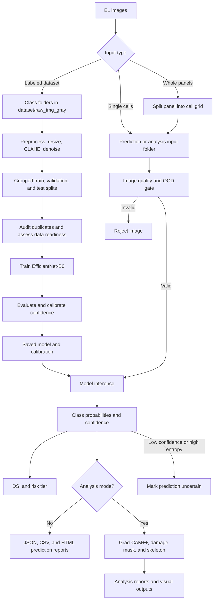
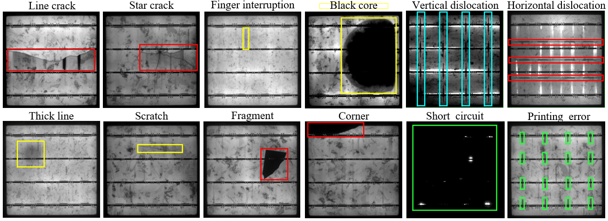

# Solar Panel EL Defect Detection

A Python and PyTorch project for classifying defects in electroluminescence
(EL) images of photovoltaic cells. The project provides preprocessing,
EfficientNet-B0 training, batch prediction, out-of-distribution (OOD) checks,
Damage Severity Index (DSI) scoring, panel-to-cell splitting, morphological
skeleton extraction, and Grad-CAM analysis.

## Workflow



The training branch prepares and validates the model. The inference branch
accepts individual cell images or splits whole-panel images into cells before
classification. Invalid inputs are rejected, while low-confidence outputs are
retained as `UNCERTAIN` for human review.

## Features

- Classifies 10 solar-cell conditions and defect types.
- Fine-tunes an ImageNet-pretrained EfficientNet-B0 model.
- Preprocesses grayscale EL images with CLAHE and denoising.
- Creates grouped train, validation, and test splits.
- Rejects invalid images and flags uncertain predictions.
- Calculates a continuous DSI score from 0 to 100.
- Splits whole-panel images into configurable cell grids.
- Generates Grad-CAM heatmaps and defect-area estimates.
- Exports prediction and analysis results as JSON, CSV, and HTML.
- Extracts morphological defect skeletons and overlays.

## Quick Start

### Setup

Run commands from the project root. Python 3.12 is used by the GitHub test workflow.

```powershell
python -m venv venv
venv\Scripts\Activate.ps1
python -m pip install --upgrade pip
python -m pip install -r requirements.txt
```

On Linux or macOS, activate with `source venv/bin/activate`.
Datasets, trained weights, calibration files, and inspection history are local
assets and are **not included in this repository**. To run inference, train a
10-class model using the workflow below or supply a compatible trusted checkpoint
at `models/solar_defect_cnn_10class.pth` and its matching calibration at
`models/confidence_calibration_10class.json`. The dashboard can start without a
checkpoint, but processing images requires one. Training downloads ImageNet
weights on first use and requires internet access then.

### Local web beta

After setup, double-click `start_beta.bat`, or run:

```powershell
python web_app.py
```

Open **http://127.0.0.1:8765**. Upload cell or panel images, preview the panel
grid, run an inspection, review results and optional visual analysis, and export
CSV/JSON reports. Keep the terminal open. This beta is local to your computer;
multi-user authentication and remote deployment are not included.
See [web/README.md](web/README.md) for limits and operation.

### Command-line workflow

After setup, place labeled images in `dataset/raw_img_gray/<class>/` and run:

```powershell
python main.py preprocess
python main.py audit-dataset
python main.py train
python main.py evaluate
python main.py calibrate-confidence
python main.py predict
```

For explainable visual analysis, place images in `img_for_analysis/` and run:

```powershell
python main.py analyse
```

## Supported Classes

1. `normal`
2. `black_core`
3. `corner`
4. `crack`
5. `finger`
6. `horizontal_dislocation`
7. `scratch`
8. `short_circuit`
9. `star_crack`
10. `thick_line`

Excluded for this version: fragment, printing_error, and vertical_dislocation.
Train and calibrate a compatible 10-class checkpoint before prediction. Excluded defects are outside the
supported scope and are not automatically recognized as unknown.

### EL Defect Reference

The following annotated EL examples provide a visual reference for the defect
patterns represented by the dataset. The `Line crack` example corresponds to
the project's `crack` class, while `Finger interruption` corresponds to
`finger`. The `normal` class is not shown.



> This figure is a visual guide only. The highlighted regions illustrate
> typical appearances and are not bounding-box labels used to train this
> image-classification model.

## Project Structure

Shared paths, classes, image size, training parameters, and severity weights
are defined in `scripts/config.py`.

```text
solar-cell-inspection/
|-- main.py                    Unified command-line interface
|-- web_app.py                 Local HTTP server
|-- start_beta.bat             Windows launcher
|-- web/                       Dashboard assets
|-- .github/workflows/         Automated tests
|-- diagnose_ood.py            OOD threshold diagnostics
|-- requirements.txt
|-- docs/images/               README reference images
|-- dataset/
|   |-- raw_img_gray/          Source images grouped by class
|   |-- transformed_img/       Preprocessed images
|   |-- train/                 Training split
|   |-- val/                   Validation split
|   |-- test/                  Test split
|   `-- skeleton_img/          Skeletons and overlays
|-- img_for_prediction/        Default batch-prediction input
|-- img_for_analysis/          Default deep-analysis input
|-- models/
|   |-- solar_defect_cnn_10class.pth   Trained checkpoint
|   |-- confidence_calibration_10class.json
|   `-- training_log_10class.json      Epoch metrics
|-- results/
|   |-- predictions/           Prediction reports
|   |-- analysis/              Analysis reports and heatmaps
|   |-- evaluation/            Metrics and confusion matrices
|   |-- dataset_audit/         Duplicate-leakage reports
|   `-- data_readiness/        Class-support reports
|-- tests/
|   |-- test_core.py
|   `-- test_web.py
`-- scripts/
    |-- config.py
    |-- preprocess.py
    |-- train.py
    |-- predict.py
    |-- analyse.py
    |-- skeleton.py
    |-- ood_detector.py
    |-- confidence_calibration.py
    |-- evaluate.py
    |-- audit_dataset.py
    |-- data_readiness.py
    |-- calibrate_ood.py
    `-- panel_splitter.py
```

## Requirements

- Python 3.10 or newer
- A CUDA-capable GPU is recommended for training
- Windows, Linux, or macOS

Follow the virtual-environment instructions in [Setup](#setup).

## Dataset Preparation

Place source images under class-named folders:

```text
dataset/raw_img_gray/
|-- normal/
|-- crack/
|-- finger/
|-- short_circuit/
`-- ...
```

Then run:

```powershell
python main.py preprocess
```

The preprocessing step resizes images to `224 x 224`, applies CLAHE and
Gaussian denoising, and creates train, validation, and test splits.

> **Warning:** preprocessing rebuilds the class folders inside
> `dataset/train`, `dataset/val`, and `dataset/test`. Back up manually curated
> splits before running it.

## Training

```powershell
python main.py train
```

The best validation checkpoint is saved to:

```text
models/solar_defect_cnn_10class.pth
```

Training metrics are written to:

```text
models/training_log_10class.json
```

Training uses weighted sampling, data augmentation, AdamW, cosine learning-rate
decay, gradient clipping, and early stopping. The existing checkpoint can be
used without retraining unless the dataset, class definitions, or model
architecture changes.

## Batch Prediction

Place images in `img_for_prediction/`, then run:

```powershell
python main.py predict
```

Use a different input folder or checkpoint:

```powershell
python main.py predict --src path\to\images --model path\to\model.pth
```

Reports are saved under `results/predictions/`.

## Model Evaluation

Evaluate the trained model on `dataset/test/`:

```powershell
python main.py evaluate
```

Use a different labeled dataset or checkpoint:

```powershell
python main.py evaluate --dataset path\to\dataset --model path\to\model.pth
```

The evaluator reports accuracy, macro precision, macro recall, macro F1, and
per-class metrics. It saves JSON, CSV, and a confusion-matrix image under
`results/evaluation/`.

Check progress toward an independent external test set:

```powershell
python main.py external-readiness
```

After every class has at least 30 independently sourced images and all
independence checks pass, freeze it before evaluation:

```powershell
python main.py external-readiness --freeze
python main.py evaluate --dataset dataset\external_test
```

## Dataset Leakage Audit

Check train, validation, and test splits for exact and near-duplicate images:

```powershell
python main.py audit-dataset
```

The audit uses SHA-256 hashes for exact matches and a conservative perceptual
hash comparison for visually near-identical images. Reports are written under
`results/dataset_audit/`.

## Data Readiness

Report classes that need more unique images:

```powershell
python main.py data-readiness
```

The command writes reports under `results/data_readiness/` and creates
class-specific intake folders under `dataset/collection_needed/`. Review new
images before moving them into `dataset/raw_img_gray/<class>/`, then preprocess
and retrain.

## Confidence Calibration

Calibrate probability confidence and uncertainty thresholds using validation
data:

```powershell
python main.py calibrate-confidence
```

The saved `models/confidence_calibration_10class.json` is tied to the model checkpoint
hash and is loaded automatically by prediction and analysis. Recalibrate after
every retraining.

## Automated Tests

Run the built-in unit and integration tests:

```powershell
python main.py test
```

The suite covers preprocessing helpers, DSI scoring, OOD thresholds, panel
splitting, evaluation metrics, calibration loading, data-readiness rules, and
CLI parsing.

## Whole-Panel Prediction

Split each panel into a fixed grid before inference:

```powershell
python main.py predict --src path\to\panels --split-panel --panel-rows 6 --panel-cols 10
```

Optional trimming controls:

```powershell
python main.py predict --split-panel --panel-margin-pct 2 --panel-gap-pct 4
```

## Deep Analysis

Place images in `img_for_analysis/`, then run:

```powershell
python main.py analyse
```

Analysis includes prediction, confidence, DSI, risk tier, estimated defect
area, and Grad-CAM heatmaps. Outputs are stored in `results/analysis/`.

Whole-panel analysis is also supported:

```powershell
python main.py analyse --src path\to\panels --split-panel --panel-rows 6 --panel-cols 10
```

## Skeleton Extraction

```powershell
python main.py skeleton
```

By default, this processes `dataset/transformed_img/` and writes skeletons and
overlays to `dataset/skeleton_img/`.

## Full Pipeline

```powershell
python main.py pipeline
```

This runs preprocessing, skeleton extraction, training, prediction, and deep
analysis in sequence. It can take a long time and rebuilds the dataset splits.
Evaluation, dataset auditing, data-readiness checks, and confidence calibration
are separate commands so their results can be reviewed before deployment.

## OOD Diagnostics

The inference pipeline performs:

1. Image size, variation, and saturation checks.
2. Minimum model-confidence checks.
3. Prediction-entropy checks.

Inspect how the current thresholds behave on training images:

```powershell
python diagnose_ood.py
```

Calibrate structural statistics from the local dataset:

```powershell
python scripts\calibrate_ood.py
```

Review generated calibration files before enabling structural checks in
`scripts/ood_detector.py`.

## DSI Interpretation

| DSI | Level |
|---:|---|
| 0-19.99 | No Damage |
| 20-39.99 | Minor Damage |
| 40-59.99 | Moderate Damage |
| 60-79.99 | Significant Damage |
| 80-100 | Severe Damage |

DSI is a probability-weighted score based on configured class severity
weights. It is a project-specific indicator, not a certified engineering
measurement.

## CLI Help

```powershell
python main.py --help
python main.py predict --help
python main.py analyse --help
```

## Production Status

This project is suitable as a research prototype or human-assisted inspection
tool. Before production deployment, validate it on independent images from the
target cameras and sites, measure per-class precision and recall, calibrate
confidence and DSI thresholds, extend automated tests and monitoring, version the
dataset and model, and retain human review for uncertain or high-risk results.

The model should not be the sole basis for safety, warranty, maintenance, or
financial decisions.

## Publishing to GitHub

The `.gitignore` excludes virtual environments, datasets, model weights, uploaded
images, inspection databases, generated reports, temporary files, and local
credentials. Keep these assets locally; a clone needs its own data and model.
Do not use GitHub's browser folder upload for the whole working directory,
because it does not apply Git ignore rules.

From the project root, initialize Git if needed and review the staged files:

```bash
git init -b main
git add .
git diff --cached --stat
git status --short
git commit -m "Initial solar cell inspection project"
```

Create an empty GitHub repository, then use its actual URL:

```bash
git remote add origin https://github.com/YOUR-USERNAME/YOUR-REPOSITORY.git
git push -u origin main
```

GitHub Actions runs the unit and HTTP integration tests on Python 3.12 without
shipping local datasets or checkpoints. For local verification, run
`python -m unittest discover -s tests -v`.

## License

No open-source license has been selected. Publishing source does not grant an
open-source license. Choose a license before inviting reuse, and confirm rights
to any images or model artifacts you choose to distribute separately.
